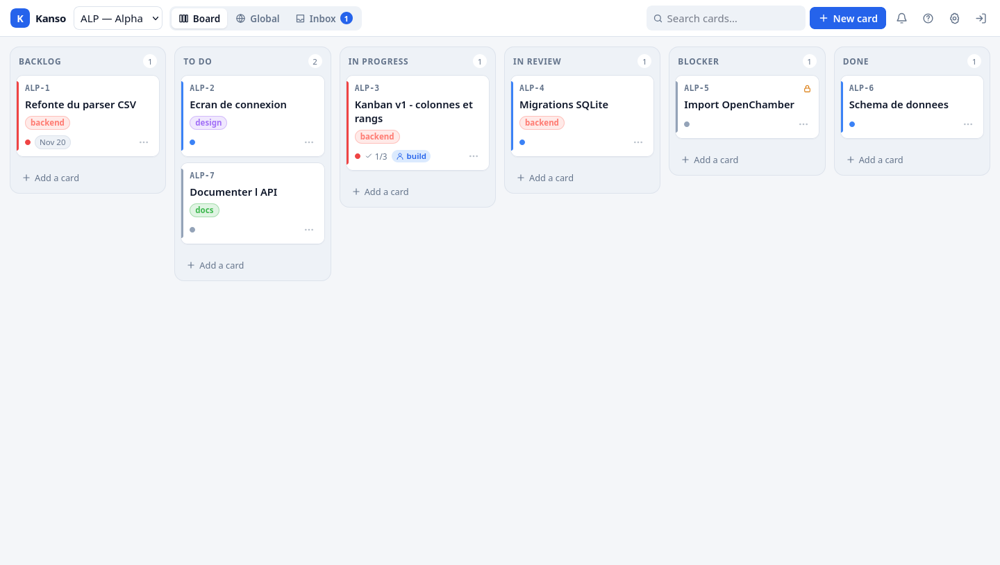
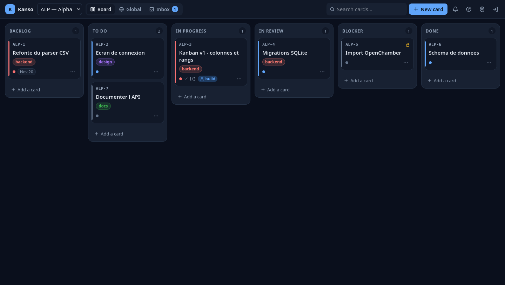
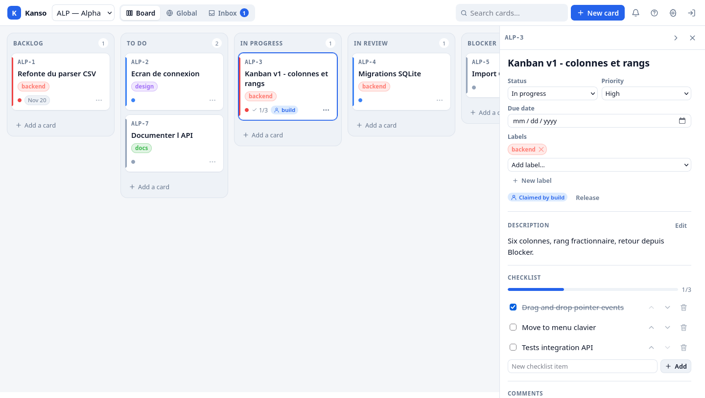
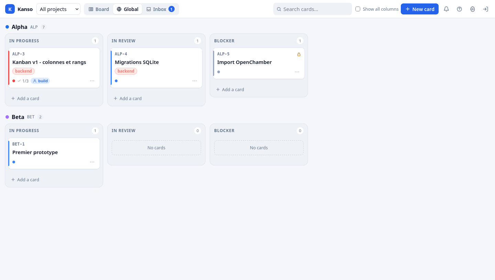
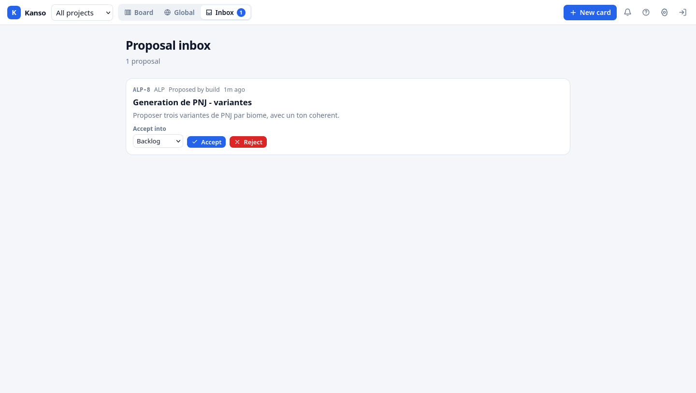
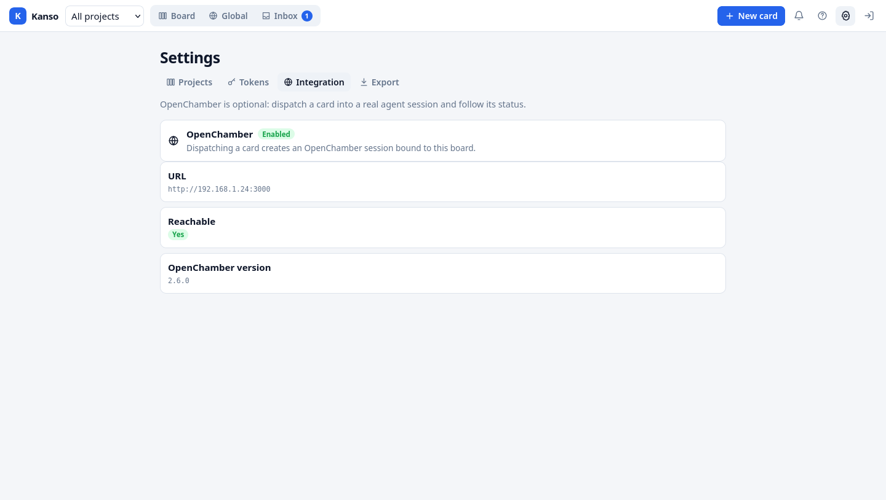
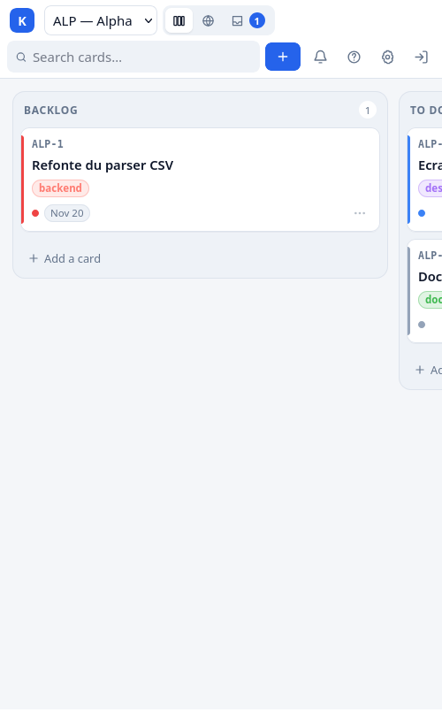
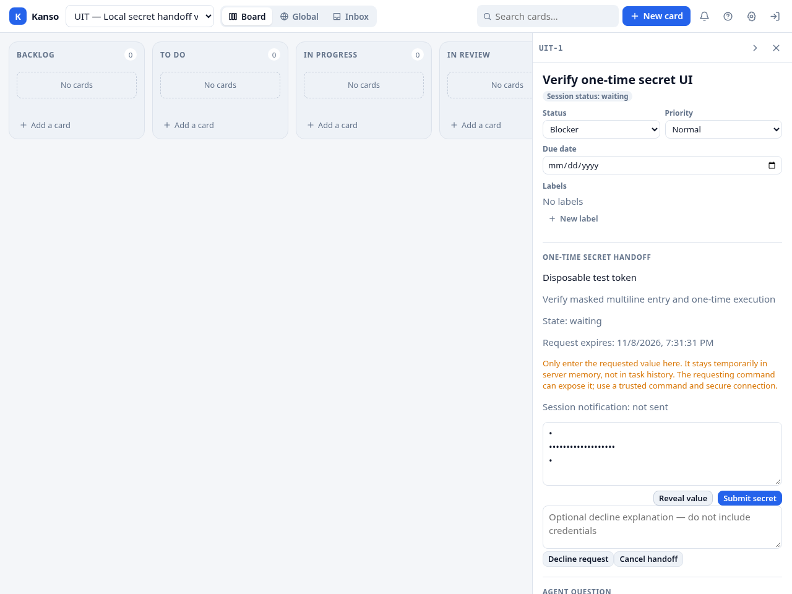

# Kanso

External task imports: see [Imports](docs/IMPORTS.md). Provider support is not yet enabled.

A single-user kanban board for your projects, with **optional** OpenCode /
OpenChamber agent sessions.

The design, scope and milestone plan live in [PLAN.md](PLAN.md). It is the
reference for the architecture, data model, HTTP API, CLI and roadmap; the code
and its tests show what is implemented today. This README covers building,
running, testing and configuring the project.

## Features

- Project boards with six fixed columns, drag & drop, a global cross-project
  view and a proposal inbox.
- Cards with Markdown descriptions, labels, due dates, checklists, comments,
  dependencies, claims and an activity log.
- A CLI and agent skill for the pull flow, plus an optional OpenChamber adapter
  that dispatches a card into an agent session and follows it.
- A versioned JSON export of every project, card, label and comment from
  **Settings → Export** or `GET /api/export.json`.
- Opt-in browser notifications when a card needs attention or enters review
  while the tab is hidden.
- Keyboard shortcuts, including `n`, `/`, `j`/`k`, `m`, `Esc` and `?`; the
  question-mark button in the top bar opens the same help dialog.

## Screenshots

Captured from the M7 build; the PNG files are committed after review.

| | |
| --- | --- |
|  |  |
|  |  |
|  |  |
|  | |

## Requirements

- Rust 1.89 or newer (`rust-version` in `Cargo.toml`)
- SQLite is compiled in through `rusqlite`'s `bundled` feature, so no system
  SQLite is needed.

## Build and run

```sh
cargo build
KANSO_PASSWORD=dev KANSO_DATA_DIR=./data cargo run -- serve
curl http://127.0.0.1:8087/api/health
# {"status":"ok","version":"0.6.0","db":"ok"}
```

`cargo run -- serve --port 9000 --data-dir /tmp/kanso` replaces the port in
`KANSO_BIND` and overrides `KANSO_DATA_DIR`. The database is created at
`<data_dir>/kanso.db` with WAL enabled and migrations applied at startup.

## Configuration

| Variable | Required | Default | Purpose |
| --- | --- | --- | --- |
| `KANSO_PASSWORD` | yes | — | UI password; startup fails when missing or empty |
| `KANSO_DATA_DIR` | no | `/data` | Directory holding `kanso.db` |
| `KANSO_PUBLIC_URL` | no | — | Public base URL; `https://` makes the session cookie `Secure` and its host is accepted as a CSRF origin |
| `KANSO_BIND` | no | `0.0.0.0:8087` | Listen socket address (`IP:port`) |
| `KANSO_LOG` | no | `info` | `tracing` filter, e.g. `info,kanso=debug` |
| `KANSO_OPENCHAMBER_URL` | no | — | OpenChamber base URL; enables the optional adapter only together with the token |
| `KANSO_OPENCHAMBER_TOKEN` | no | — | `oc_client_…` bearer token for OpenChamber; never returned by the API |

Logs go to stdout without ANSI colours, which is journald-friendly. SIGINT and
SIGTERM trigger a graceful shutdown with a 10-second drain deadline.

Browser notifications and keyboard shortcuts have no server configuration.
Notifications are requested only after a user action — the bell or the switch
on **Settings → Export** — and `?` opens the shortcut help unless an input is
focused.

## CLI

`kanso` is both the server and the client. Write a client config once:

```sh
kanso config init --url https://kanso.example --token kanso_…
```

`config init` validates the token with `GET /api/me`, prints the identity and
writes `~/.config/kanso/config.toml` atomically with mode 0600. It refuses to
replace an existing file without `--force`. `KANSO_URL` and `KANSO_TOKEN`
override the file per value; `KANSO_CONFIG` overrides its path.

```sh
kanso project list | add --key ALP --name Alpha | show ALP | edit ALP --name …
kanso task list [--project ALP] [--status todo] [--label bug] [--mine]
kanso task show ALP-42
kanso task add "Title" --project ALP [--description …] [--status todo] [--priority high] [--label NAME|ID]…
kanso task edit ALP-42 [--title …] [--description …] [--due 2026-12-01]
kanso next [--project ALP] [--claim]
kanso claim ALP-42
kanso release ALP-42
kanso move ALP-42 in_review | blocker --reason "…" | restore
kanso comment ALP-42 "text"             # "-" reads stdin
kanso check ALP-42 --add "item" | --done 2 | --list
kanso depend ALP-42 on ALP-40
kanso propose "Idea" --project ALP [--description …] [--label NAME|ID]…
kanso inbox
kanso session link ALP-42 ses_… --directory /path/to/worktree
kanso token create --name build --scope agent   # prints the token once
kanso token list | revoke build
kanso skill [--print] [--install [--dir ~/.config/opencode/skills]]
kanso backup [--out DIR]
```

Output is aligned plain text with no colour or ANSI escapes. For commands that
talk to the API, `--json` prints the API's own JSON unchanged. Runtime errors go
to stderr as `kanso: <code>: <message>`; clap prints its own `error: …` usage
text. Exit codes are `0` success, `1` usage or start-up, `2` API/network/local
I/O error and `3` conflict (already claimed, dependency unmet, not active, not
claimable, not claimed, rate limited).

`next`, `claim`, `comment`, `move`, `propose` and `check` accept
`--agent <name>`. It sends `X-Kanso-Agent`, which overrides the token name in
comments, activity and `created_by` (not `claimed_by` or claim ownership). The header is honoured only for
agent-scope tokens; a human token ignores it, and an empty, over-long, reserved
(`ui`) or control-character name is a validation error.

`kanso skill --print` writes the embedded `skills/kanso/SKILL.md`; `kanso skill
--install` writes `<dir>/kanso/SKILL.md` (default
`~/.config/opencode/skills`), creating parents and reporting whether it
installed, updated or found the file already up to date.

`kanso backup` asks the server to run `VACUUM INTO` under
`<data_dir>/backups/` and prints the server-side path. `--out DIR` is resolved
by the server under the data directory; paths that escape it are rejected. There
is no download endpoint in this milestone, so a host directory cannot be
targeted directly.

## Checks

```sh
cargo fmt --check
cargo clippy --all-targets -- -D warnings
cargo test
```

CI runs the same commands plus a container build.

## Software bills of materials

Two CycloneDX 1.5 JSON SBOMs describe the release:

- `kanso-backend.cdx.json` lists every crate in `Cargo.lock` for the
  `x86_64-unknown-linux-musl` build.
- `kanso-frontend.cdx.json` lists the frontend npm dependencies and records the
  SHA-256 of the vendored `web/vendor/marked.min.js`.

Generate them locally with the same script CI uses:

```sh
cargo install cargo-cyclonedx --version 0.5.10 --locked
./scripts/sbom.sh            # writes dist/sbom/*.cdx.json
./scripts/sbom.sh /tmp/sbom  # or another output directory
```

Node.js and npm are needed for the frontend document (npm 9.8 or newer provides
`npm sbom`); no `node_modules` install is required. CI uploads the pair as the
`kanso-sbom` artifact on every push and pull request, and a `v*` tag attaches
both files to the GitHub release. The frontend package version in
`web/package.json` must match `Cargo.toml`; `tests/sbom.rs` enforces that and
checks the lockfile against the vendored `marked` build.

Scan them with any CycloneDX consumer, for example:

```sh
grype sbom:dist/sbom/kanso-backend.cdx.json
trivy sbom dist/sbom/kanso-frontend.cdx.json
```

`cargo-cyclonedx` honours `SOURCE_DATE_EPOCH`; npm stamps its document with the
generation time.

## Container

```sh
podman build -f Containerfile -t kanso .
podman run --rm -p 127.0.0.1:8087:8087 \
  -e KANSO_PASSWORD=dev -v kanso-data:/data kanso
```

The image is a multi-stage musl build on Alpine, runs as uid/gid 1000, keeps
data in the `/data` volume, exposes port 8087 and probes `/api/health`.

The image includes GitHub CLI for the GitHub importer. Its configuration lives
in `/data/.config/gh` (`GH_CONFIG_DIR`), so persist `/data` across container
replacements. An operator can run `podman exec -it <container> gh auth login
--hostname github.com --web --git-protocol https --skip-ssh-key` and
complete the browser/device flow; the login
must run as the container's uid 1000 and use the same persisted `/data` as the
server. For the rootless production service, invoke Podman as the service user
with its `XDG_RUNTIME_DIR`, as shown in [the runbook](docs/DEPLOY.md). Browser
approval can happen on another machine, but a separate host login does not
automatically authenticate the container. All Kanso humans will share this
GitHub identity. The standard gh login grants write-capable scopes: use a
dedicated account with read-only access only to the intended repositories; do
not grant it access to unrelated private repositories.

GitHub CLI may store credentials in plaintext when no credential store is
available. Restrict access to the volume and its backups, and do not expose or
copy its gh configuration into the image, logs, or project files. For rootless
Podman, verify that user-namespace ownership and volume permissions permit the
container's uid 1000 to read and write this directory. Never print the token.

## Deployment

The production image is `ghcr.io/dupremathieu/kanso:latest`; a `v*` git tag
also publishes that tag and attaches the static
`kanso-x86_64-unknown-linux-musl` binary and both CycloneDX SBOMs to the GitHub
release. The binary asset is a bare executable: run it from a source checkout
or put the matching `web/` directory beside it, since the container image is
the self-contained distribution.
Production runs as a rootless Podman Quadlet behind host nginx, with a daily
backup timer. The Quadlet, nginx and app env templates in `deploy/` are rendered
by `deploy/render.sh` from `deploy/deploy.env` (see
`deploy/deploy.env.example`); the backup units and `kanso.network` are used
directly. The example domain is `kanso.example.com`. TLS is selected in
`deploy/deploy.env`; the committed nginx template carries no certificate or
host TLS paths. The full operator runbook — install, verification, update,
backup and restore, rollback and troubleshooting — is
[docs/DEPLOY.md](docs/DEPLOY.md).

## HTTP surface

All API responses are JSON except the SSE stream; timestamps are Unix milliseconds. Failures use
`{"error":{"code":"...","message":"..."}}` with codes `validation`,
`unauthorized`, `forbidden`, `not_found`, `conflict`, `csrf`, `rate_limited`
and `internal` (500), plus the specific conflict codes `already_claimed`,
`not_claimable`, `dependency_unmet`, `not_claimed`, `not_active`,
`not_proposed`, `already_dispatched`, `not_blocked`, `no_session`,
`not_a_reply` and `already_sent`. The optional OpenChamber adapter adds
`integration_disabled`/`integration_unreachable` (503) and
`openchamber_error` (502). `GET /api/health` and `POST /api/auth/login` are public; every
other `/api` route needs a session cookie or `Authorization: Bearer kanso_...`.

### Authentication and meta

| Method | Path | Notes |
| --- | --- | --- |
| `POST` | `/api/auth/login` | `{password}` → `204` + HttpOnly `kanso_session` cookie (30 days) |
| `POST` | `/api/auth/logout` | Deletes the session and clears the cookie |
| `GET` | `/api/me` | `{kind:"ui"\|"token", name, scope}` |
| `GET` | `/api/health` | `{status, version, db}` |
| `GET` | `/api/events` | Server-Sent Events; cookie or bearer auth |
| `GET` | `/api/integration` | `{openchamber:{enabled,url,reachable,version}}`; disabled is `{enabled:false}` |

Failed logins are limited to five per minute per client address (`429`,
`rate_limited`). Cookie-authenticated `POST`/`PATCH`/`DELETE` requests must carry
an `Origin` (or `Referer`) whose host matches the request `Host` or
`KANSO_PUBLIC_URL`; bearer-token requests are exempt from CSRF checks. A cookie
request to `GET /api/agent/next?claim=1` mutates state, so it needs the same
origin check; read-only GETs such as `/api/export.json` do not.

### Projects

| Method | Path | Notes |
| --- | --- | --- |
| `GET` | `/api/projects` | Active projects; `?archived=1` includes archived ones |
| `POST` | `/api/projects` | `{key,name,description?,repo_path?,color?,model?}` |
| `GET` | `/api/projects/:id_or_key` | Case-insensitive key |
| `PATCH` | `/api/projects/:id` | Name, description, key, colour, repo and OpenChamber fields |
| `POST` | `/api/projects/:id/archive` | Idempotent |
| `GET` | `/api/projects/:id_or_key/board` | `{project, columns}` for one project |
| `GET` | `/api/board` | `{projects:[{project,columns}]}`; `?project=` limits it to one |

Project keys are 2–6 characters of `A-Z`/`0-9`, stored uppercase and unique
case-insensitively.

A project `model`, and a dispatch model override, use the
`provider/model[#variant]` syntax (for example
`opencode-go/deepseek-v4.1-flash#max`). The optional `#variant` is the
OpenChamber/OpenCode thinking level. Kanso splits the value and sends `model`
and `variant` as separate fields, so the `#` never appears in the model id.
Without `#`, no `variant` is sent. OpenChamber then resolves the level from the
agent pin, the project or Settings default for the model, the model's last-used
level, and finally Default, in that order. As a result, omitting `#variant`
does **not** guarantee the model's Default level: dispatch can inherit a
previously used level and change as UI history changes. Specify an available
`#variant` (for example `#low`) to request a particular level. Kanso cannot
currently force OpenChamber's Default level when no variant is specified.

Empty or `null` means no project model; on dispatch, an empty override keeps
the project value. An invalid model is
`422 validation`. A project row written before this validation and holding a
value that is not `provider/model[#variant]` keeps working until it is used:
dispatch and the next project save then reject it with the same `422` so it can
be corrected.

### Tasks

| Method | Path | Notes |
| --- | --- | --- |
| `GET` | `/api/tasks` | `project`, `status`, `state`, `label`, `q`, `claimed_by`, `attention`, `limit` (100, max 500), `offset` |
| `POST` | `/api/tasks` | `{project_id\|project_key,title,description?,status?,priority?,due_date?,labels?}`; an agent token creates a proposal instead |
| `GET` | `/api/tasks/:ref` | `ALP-42` (case-insensitive) or UUID; includes labels, checklist, comments, activity and dependencies |
| `PATCH` | `/api/tasks/:ref` | `title`, `description`, `priority`, `due_date`, `labels`; other fields are rejected |
| `POST` | `/api/tasks/:ref/move` | `{status?,before?,after?,restore?,reason?}`; `reason` (max 500 characters) is stored in `blocked_reason` when entering `blocker` |
| `POST` | `/api/tasks/:ref/claim` | Human or agent; sets `claimed_by`, status → `in_progress` |
| `POST` | `/api/tasks/:ref/release` | Clears the claim, keeps the column |
| `POST` | `/api/tasks/:ref/session` | Human only; `{session_id,directory,status?}` with status `running` by default (also `idle`, `waiting`, `failed`, `offline`) |
| `POST` | `/api/tasks/:ref/dispatch` | Human only; optional `{agent?,model?,worktree?}` overrides; creates an OpenChamber session for the card when the adapter is enabled. `worktree` is a boolean defaulting to the project setting. |
| `POST` | `/api/tasks/:ref/reply` | Human only; `{body}`; records the answer as a comment and forwards it into the card's OpenChamber session |
| `POST` | `/api/tasks/:ref/reply/:comment_id` | Human only; retries a failed or unknown reply with the stored prompt and session |
| `POST` | `/api/tasks/:ref/dependencies` | `{blocked_by:[ref,…]}` replaces the set; `[]` clears it (human only) |
| `POST` | `/api/tasks/:ref/archive` | Human only in M2 |
| `POST` | `/api/tasks/:ref/restore` | Human only in M2 |
| `DELETE` | `/api/tasks/:ref?hard=true` | Human only; cascades to children |

`GET /api/tasks` defaults to `state=active`; use `?state=archived` or
`?state=proposed` for the archive or the proposal inbox. Task numbers are
allocated per project inside the create transaction. New cards append to their
column with the fractional rank helper described in `PLAN.md`.

`move` inserts at the top (`before`), bottom (neither neighbour) or between two
neighbouring cards (`after` is the preceding card and `before` the following
one; both must be adjacent among the visible active cards). When the midpoint
gap falls below `1e-6`, the target column is renumbered `1..n` in the same
transaction. Entering `blocker` stores `blocked_from`; `restore:true` returns to
that column, an explicit `status` wins over `restore`, and a move with neither
clears `blocked_from`/`blocked_reason` while keeping the card in `blocker` —
unless it sends `reason`, which updates `blocked_reason` in place and keeps
`blocked_from`. Entering `done` sets `done_at`; leaving it clears the timestamp.

A card in `blocker` shows its `blocked_reason` as the agent's question. The human
answers with `POST /api/tasks/:ref/reply`: Kanso stores the answer as an ordinary
comment (author = human) and forwards a wrapper into the card's existing session.
The reply route answers `201 {comment, delivery}` as soon as the comment exists,
even when delivery fails:

```json
{"comment": {"id": "…", "author": "ui", "body": "…", "created_at": 0,
             "delivery_status": "sent", "delivery_error": null},
 "delivery": {"status": "sent", "session_id": "ses_…", "error": null}}
```

`delivery.status` is `sent` (2xx with `promptDispatched:true`), `failed` (a 2xx
with `promptDispatched:false`, or an HTTP error) or `unknown` (a transport error
or an invalid 2xx body: the prompt may have arrived). A reply comment carries
`delivery_status` and `delivery_error`; ordinary comments have both `null`.
`POST /api/tasks/:ref/reply/:comment_id` reuses the stored `reply_prompt`,
session id and directory, so a retry is byte-identical (the prompt names the
comment id so the agent can ignore a duplicate). Retrying a `sent` reply is
`409 already_sent`; a normal comment is `409 not_a_reply`.

Replies require an active card in `blocker` with an agent session
(`409 not_blocked`, `409 no_session`) and an enabled integration
(`503 integration_disabled`). The reply itself never moves the card: on `sent`
Kanso sets the card's `session_status` to `running`, clears `attention` and
leaves the status alone, so the agent remains responsible for moving the card
out of `blocker`. The panel notifies the human when a card enters `blocker` with
a reason or a session.

An agent-scope bearer token may send `X-Kanso-Agent: <name>` to override its
token name in comments, activity and `created_by`. Claim ownership (`claimed_by`,
release checks) stays the token principal. The header is ignored
for human tokens and rejected with `400 validation` when the name is empty,
longer than 64 characters, contains a control character or is `ui`.

`claim` requires an active card in `backlog`/`todo`, no existing claim, and every
`blocked_by` card in `done`; failures are `409 already_claimed`,
`dependency_unmet` or `not_claimable`. `release` returns `409 not_claimed` when
there is nothing to release. `/api/agent/next` considers only unclaimed active
cards in `backlog`/`todo`, in non-archived projects, whose `blocked_by` cards are
all `done`; it returns the best one (`high` priority first, then earliest due
date with NULLs last, then rank and number) and `204` when none is available.
`claim=1` claims it atomically in the same transaction. A proposal (`state=proposed`) never appears in `/api/tasks`
default listings, the board or `next`; `GET /api/tasks?state=proposed` still
returns it.

Dependencies accept references from any project. A self-dependency or a cycle
is `400 validation`; an unknown reference is `404 not_found`.

### Inbox

| Method | Path | Notes |
| --- | --- | --- |
| `GET` | `/api/inbox` | Proposed cards, newest first |
| `POST` | `/api/inbox/:ref/accept` | Human only; `{status?}`, default `backlog`; appends to the column |
| `POST` | `/api/inbox/:ref/reject` | Human only; archives the proposal |

Accepting or rejecting a card that is not proposed returns `409 not_proposed`.

### Board shape

`GET /api/projects/:id_or_key/board` returns `{project, columns}` and
`GET /api/board` returns `{projects:[{project,columns}]}`. `columns` always has
`backlog`, `todo`, `in_progress`, `in_review`, `blocker` and `done`; each array
contains active cards ordered by `rank` then `number`. A card carries `id`,
`reference`, `title`, `status`, `priority`, `due_date`, `labels`, `claimed_by`,
`attention`, `session_status`, `blocked_from`, `blocked_reason`, `checklist_done`,
`checklist_total` and `blocked` (an unfinished `blocked_by` card) — not the full
detail. The checklist counters and `blocked` flag are additions needed by the
web cards, which show `2/3` progress and a lock without fetching every detail.
The global view lists active projects in `position` order; `?project=` resolves
one project (archived or not).

### Events

`GET /api/events` is a `text/event-stream`. Each frame has `event: <type>`,
`id: <n>` and a `data:` JSON object `{"id":n,"type":"<type>","data":{…}}`.
The server sends a `: heartbeat` comment every 25 s. IDs are monotonic inside
one process and restart at 1 after a restart, so clients refetch on reconnect.
A lagged or stalled subscriber is disconnected instead of blocking publishers.

Event types include `task.created`, `task.updated`, `task.moved`, `task.claimed`,
`task.released`, `task.archived`, `task.restored`, `task.deleted`,
`dependencies.changed`, `proposal.created`, `proposal.accepted`,
`proposal.rejected`, `project.created`, `project.updated`, `project.archived`,
`comment.created`, `comment.updated`, `checklist.created`, `checklist.updated`,
`checklist.deleted`, `label.created`, `label.updated` and `label.deleted`.
Task events carry the card summary under `data.task`; `task.moved` also carries
`from`, `to`, the activity kind (`moved`, `blocked` or `unblocked`) and the
ordered target `column`; `task.archived`/`task.restored` also carry `column`;
`dependencies.changed` carries `task` and the full `dependencies` object;
checklist creation/update events carry `task_id` plus `item` (updates also carry
the full reordered `checklist`), and `checklist.deleted` carries `task_id` and
`item_id`. Token and session events are deliberately not broadcast.

### Labels, checklist, comments and tokens

| Method | Path | Notes |
| --- | --- | --- |
| `GET`/`POST` | `/api/labels` | `{name,color}`; names unique case-insensitively, colour `#rrggbb` |
| `PATCH`/`DELETE` | `/api/labels/:id` | Deleting detaches the label from cards |
| `POST` | `/api/tasks/:ref/comment` | `{body}`; author is `ui`, the token name, or `X-Kanso-Agent` for an agent token |
| `POST` | `/api/tasks/:ref/checklist` | `{text}` |
| `PATCH` | `/api/tasks/:ref/checklist/:item` | `{text?,done?,before?,after?}`; `after` names the preceding item and `before` the following one |
| `DELETE` | `/api/tasks/:ref/checklist/:item` | Human only in M2 |
| `GET`/`POST` | `/api/tokens` | `{name,scope}`; the `kanso_` token is returned once only; `ui` is reserved |
| `DELETE` | `/api/tokens/:id` | Revoke; repeating it is idempotent |
| `GET` | `/api/export.json` | Human only; versioned dump of projects, labels, all cards (with checklists and dependencies) and comments; downloadable attachment with `Cache-Control: no-store` |
| `POST` | `/api/backup` | Human only; `VACUUM INTO` under `<data_dir>/backups/`; body `{dir?}` resolves under the data directory |

Agent-scoped tokens may read projects, tasks, labels, boards, the inbox and
`/api/agent/next`; claim and release their own claims; move cards between
`todo`, `in_progress`, `in_review` and `blocker`; comment; add, update and
reorder checklist items; and create proposals. They may not move a card to `backlog` or `done` (nor move one out of
`backlog`), release another identity's claim, accept or reject proposals, create
active cards, edit cards, change dependencies, archive, restore or delete cards,
delete checklist items, or manage projects/labels/tokens.

Every task mutation writes an `activity` row (`created`, `proposed`, `updated`,
`moved`, `blocked`, `unblocked`, `claimed`, `released`, `accepted`, `rejected`,
`dependencies_changed`, `commented`, `reply_sent`, `reply_failed`,
`reply_unknown`, `checklist_added`, `checklist_updated`,
`checklist_removed`, `label_added`, `label_removed`, `session_linked`,
`dispatched`, `session_idle`, `session_failed`,
`session_offline`, `session_running`, `permission_auto_accept_failed`,
`dispatch_abandoned`, `archived`, `restored`)
with a small JSON `data` payload. `blocked` carries the `reason`, and a `moved`
row carries `reason` when the reason changes while the card is already blocked.
Each reply attempt writes `reply_sent`, `reply_failed` or `reply_unknown` with
`comment_id`, `session_id` and, on failure, `error`.

The data directory also holds `session.key`, a random 0600 HMAC key used to sign
session cookies; deleting it revokes every UI session.

Non-`/api` routes serve the static shell from `web/`, with history fallback to
`index.html` and `{{VERSION}}` replaced by the binary version; a missing asset
with a file extension returns 404.

## One-time secret handoffs

An agent with a linked, in-progress card can request one value with
`kanso secret request ALP-42 --label "API token" --purpose "Connect to the API"`.
Label and purpose are public metadata: never put credentials in them, comments,
or ordinary replies. The human enters the value in the dedicated blocker panel.
Use `kanso secret status <request-id>` to inspect metadata, or
`kanso secret cancel <request-id>` to cancel. After submission, execute directly:

```sh
kanso secret exec <request-id> --env API_TOKEN -- my-command --option
```

The capability is stored under `~/.local/state/kanso/secret-handoffs` in a
private directory and file; the submitted value is never stored there. Retrieval
is one-time, before the child starts: if the response is lost, the CLI crashes,
the command fails to start, or it exits unsuccessfully, request another value.
The CLI does not start a shell unless explicitly asked. The child inherits normal
streams and can disclose its environment or print the value; use trusted commands.
Sessions sharing an agent token and OS user share a trust domain. Server memory,
swap, crash dumps, privileged users and compromised processes are not protected
by the application-level no-persistence guarantee. Use HTTPS except on loopback.
Submission and decline notify the originally linked session with a request ID,
never a value or capability. Failed/unknown notifications can be retried without
replaying the value or extending expiry; inspect the displayed delivery status.
The agent still owns moving the card out of blocker. Expiry/cancellation does
not send a wake-up message.

The CLI saves its capability before creating the server request. If creation
returns an uncertain result, it reports the public request ID and retains that
capability: inspect or cancel that ID as instructed, without retrying creation
automatically. A confirmed rejection removes the local capability.

Kanso holds submitted values only in volatile memory: never in SQLite, backups,
history, saved prompts, SSE or exports. Requests expire after 24 hours; submitted
values after 15 minutes or the request deadline. Restart, session changes,
leaving blocker, archiving or token revocation invalidate retrieval. Limits are
one live request per card, 100 globally, 1 MiB of submitted bytes and 16 KiB per
value. UTF-8 whitespace/newlines are preserved; empty values and NUL are rejected.
There is no reusable vault, binary upload or plaintext credential-file mode.

| Method | Route | Access / body |
| --- | --- | --- |
| `POST` | `/api/tasks/:ref/secrets` | Agent token; `{label,purpose,id?,capability?}`. Optional private provisioning fields must be paired. Returns `{id,capability}` once; CLI prints only `id`. |
| `GET` | `/api/tasks/:ref/secrets` | Authenticated; metadata history, latest first |
| `GET` | `/api/secrets/:id` | Authenticated; metadata only |
| `POST` | `/api/secrets/:id/submit` | Human only; `{value}`; returns status and safe delivery classification, never echoes the value |
| `POST` | `/api/secrets/:id/decline` | Human only; `{explanation?}`; non-secret explanation |
| `POST` | `/api/secrets/:id/cancel` | Human or original agent token; closes waiting/ready requests |
| `POST` | `/api/secrets/:id/consume` | Original agent token plus `{capability}`; returns `{value}` at most once; intended only for the private CLI execution path |
| `POST` | `/api/secrets/:id/retry` | Human only; retries stored reference-only notification while valid |

`secret.updated` contains only `task_id` and `request_id`; `task.updated` carries
the refreshed task. The UI's multiline value input is masked/revealable and is
never a saved draft. Ordinary replies remain separate and warn against entering
credentials. See [the confirmed design](docs/KANSO-11-SPEC.md),
[security decisions](docs/DECISIONS.md#one-time-secret-handoffs-kanso-11) and
[test scenarios](docs/TESTING.md#one-time-secret-handoffs-kanso-11).



## Security

Report vulnerabilities privately through GitHub's **Report a vulnerability**
button on the [Security tab](https://github.com/dupremathieu/kanso/security/advisories/new);
read [SECURITY.md](SECURITY.md) for scope, expectations and what not to include.

## License

Apache License 2.0 — see [LICENSE](LICENSE).
