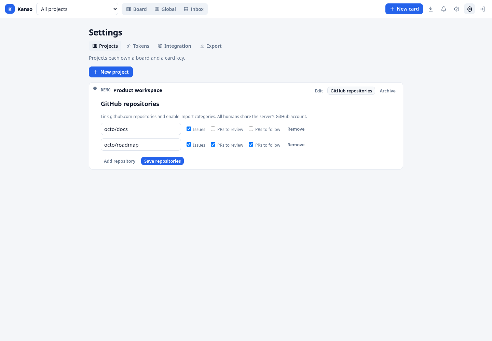
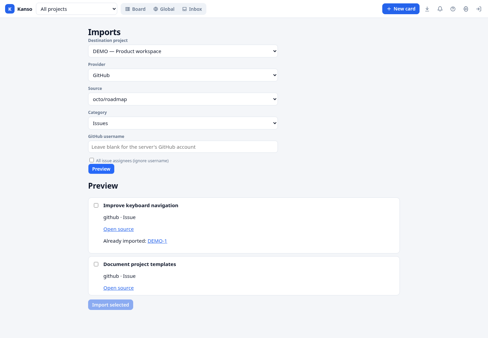
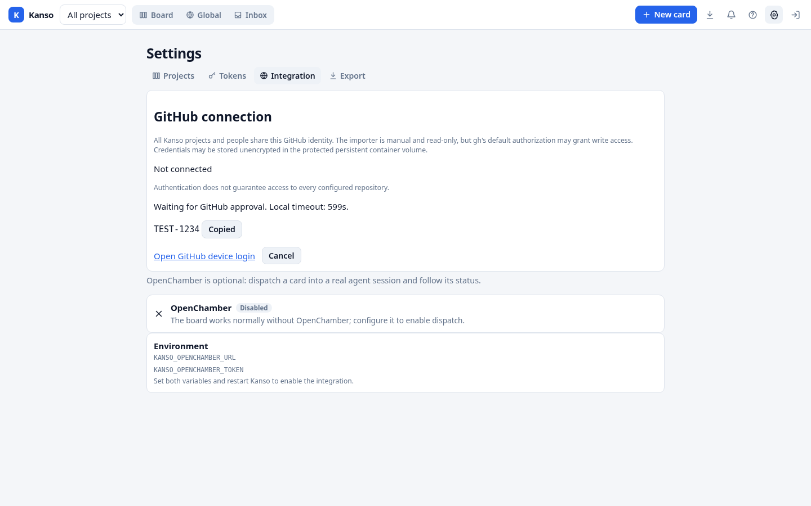
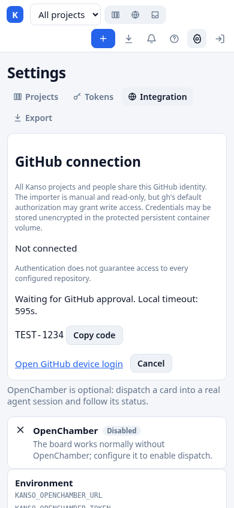

# External task imports

Open **Imports** from the board, choose an active destination project, provider,
source and any provider filters, then preview. Nothing is created until you
explicitly select candidates and choose **Import selected**. The results show
created, skipped and failed items; retrying skips existing imports, even when
the local card is archived. Local edits are never overwritten. Imports create
ordinary active backlog cards with normal priority; the task detail links to
the original. Provenance is included in JSON exports and database backups.

## GitHub

In **Settings → Projects**, open **GitHub repositories** for the destination
project. Add one or more `owner/repo` repositories and independently enable
Issues, PRs to review, and PRs to follow; save the configuration. Only humans
can configure or use imports. On **Imports**, select the destination project,
GitHub, one linked repository and one enabled category. Blank username means
the server's authenticated GitHub user. For issues, choose **All issue
assignees** to explicitly include all assignees instead. An explicit username
selects an assignee, requested reviewer, or author respectively.





The screenshots use fictional repositories and fixture data.

Issues are open issues, not PRs. Review candidates are open, non-draft PRs
with an outstanding direct request for the selected user; the authenticated
account's own PRs and team-only requests are excluded. Follow candidates are
open PRs authored by the selected user, including drafts. The GitHub node ID
deduplicates an item across repository renames and PR categories per Kanso
project; the first category and local changes remain untouched. Import is
manual and read-only: there is no sync, monitoring, notification, automatic
transition, or GitHub write. Comments, reviews, attachments and Actions logs
are not copied.

GitHub connection management is global under **Settings → Integration**; all
projects and people share the same active account. “Me” is not the current
Kanso user. Connect opens GitHub's device flow and reconnect requires explicit
confirmation of this global impact. A single login can run at a time. Its code
is visible only to the browser session that started it; a refresh in that
session resumes the local attempt. Cancel stops the local process but cannot
revoke an authorization already granted to GitHub. Browser login requires gh
2.97.0, the version tested for headless device-code output. Other versions fail
safely and use the operator-login fallback below. Kanso does not run login in
an import request and never asks for a token or device code in a comment.
The container pins Alpine's `github-cli=2.97.0-r2`; an unavailable pinned
package makes the image build fail rather than silently enabling an untested
adapter. Re-test the headless flow before changing the pin.





These screenshots and the desktop/mobile browser checks use a disposable local
server and a fake CLI. The displayed code is synthetic; no real GitHub device
authorization or credential was used. Checks covered copy, same-session reload,
another session's restricted view, and cancellation. The fake CLI was scoped to
that disposable server and was never installed into the review instance.
To repeat the browser checks after `cargo build --bin kanso`, run
`PLAYWRIGHT_MODULE=/path/to/playwright/index.mjs node scripts/test-github-settings.mjs`.
Set `KANSO_GH_SCREENSHOTS` to an existing output directory to regenerate the
two fixture screenshots. The script creates and removes its own isolated data
and fake CLI under `~/.cache/tmp/opencode`.

Install `gh` and authenticate to github.com as the same OS user and environment
as the Kanso server. A login on a laptop is not a login for a remote server.
Alternatively, on a non-container host, the operator can run
`gh auth login --hostname github.com --web --git-protocol https --skip-ssh-key`
as that server user and complete the device flow in a browser. The
[container instructions](../README.md#container) and
[deployment runbook](DEPLOY.md) cover persistence, rootless uid mapping and
credential protection. `gh` may fall back to storing credentials unencrypted;
protect the persistent volume and its backups. GitHub's default `gh` grant may
allow writes even though Kanso's importer is read-only. If `GH_TOKEN` or
`GITHUB_TOKEN` supplies the active credential, Kanso displays operator-managed
authentication and disables browser reconnect; change that environment through
the operator instead. If status or login is unavailable, the CLI is missing or
incompatible, or its output is unexpected, use the operator shell login above.
If preview fails, check that `gh` is authenticated and that the account can read
the linked repository. No raw subprocess diagnostics or credentials are returned
to the browser.

The GitHub adapter bounds each preview to 30 seconds, three pages of 100
remote records, 4 MiB per response, and 200 matching candidates. An incomplete
or failed query returns an error rather than an empty or partial success.
Oversized item content is explicitly marked invalid, not imported or silently
truncated. Repository source configuration can be removed or disabled between
preview and confirmation; confirmation checks it again transactionally.

If GitHub returns more records than these bounds permit, choose a smaller
repository or increase the adapter's bounds before retrying. Kanso will not
silently claim that a partial result is complete. After changing repository permissions or the server's gh login,
request a new preview. Never paste tokens into a repository name, username
filter, task, comment, or diagnostic report.

## Provider extension contract

Implement `importer::Provider` and register it in the server's `AppState` via
`with_import_providers`. Production registers the GitHub adapter. `info()`
describes public, non-secret provider metadata, source choices and text filter
controls; `project_info()` may resolve sources from local configuration under
the database lock and must not perform remote I/O. `preview()` validates filter semantics and performs remote I/O on a
blocking worker, without a database lock. The adapter owns authentication,
pagination, source configuration and any category-specific semantics. It must
not put credentials in controls, results, URLs, task content, logs or errors.
`info()` must be fast and nonblocking. The shared layer does not time out or
cancel `preview()`; each adapter must set connection, read and overall request
deadlines and bound pagination and response sizes itself. The shared preview
limits are enforced after the adapter returns, not while it fetches data.
All returned errors are sanitized. A source must have a stable ID; a provider
may expose multiple sources. Each candidate's `identity` must identify the
logical item across those sources, including any relevant category distinctions;
do not use mutable titles or URLs as identity. The provider ID is part of the
deduplication key, scoped to the destination project.

Previews are held only in memory, bound to the authenticated session or token,
project, provider and source, expire after ten minutes, and are limited to 200
candidates and 2 MiB. Starting a newer, well-formed preview request invalidates
the caller's prior one, even if validation or the provider call fails.
Confirmation accepts only distinct indexes into that server snapshot, not
candidate content. A restart or expired snapshot requires a new preview.
Candidate identities and kinds must be nonempty, bounded and free of control
characters; source URLs must be safe HTTP(S) URLs without userinfo. Existing
title and description limits apply. Invalid items are reported individually,
without truncation. Each successful item and its provenance is committed
atomically before its normal creation event is published.

The API endpoints are `GET /api/imports/providers`, `POST /api/imports/preview`,
and `POST /api/imports/confirm`; all require human authorization and use normal
cookie CSRF protection. Providers are trusted server-side code, not plugins or
client-supplied candidates. `tests/api.rs` contains a test-only adapter and
exercises the end-to-end flow without cloud access.

Connection management uses `GET /api/github/status` (cached status),
`POST /api/github/status` (refresh), and `GET`, `POST` or `DELETE
/api/github/login` (progress, start with `{"confirmed":true|false}`, cancel).
These endpoints require a human browser session cookie, reject all bearer
tokens, return `Cache-Control: no-store`, and use normal cookie CSRF protection
for mutations. Device material is returned only to the starting session.

## API workflow

1. `GET /api/imports/providers?project_id=<id>` returns provider IDs/names, available source
   IDs/names, and filter IDs/labels. An empty array means no provider is
   registered. Filter controls are plain text; adapters validate their semantics.
   Without `project_id`, only global metadata is returned. For GitHub, a source
   ID is `owner/repo|issues`, `owner/repo|review`, or `owner/repo|follow`, and
   only enabled sources for that project are returned. Omitting the `user`
   filter means the gh account; `{"user":""}` means all assignees for issues
   only. Other values are explicit usernames.
2. `POST /api/imports/preview` accepts the following shape (IDs below are
   illustrative):

   ```json
   {
     "project_id": "existing-project-uuid",
     "provider": "provider-id",
     "source": "source-id",
     "filters": {"query": "assigned to me"}
   }
   ```

   It returns `preview_id` and a `candidates` array. Each item has an `index`,
   normalized `candidate`, `valid` flag, and an `existing` local task reference
   or `null`. The normalized candidate contains `identity`, `kind`, `title`,
   `description`, and `source_url`. When source content cannot be copied due to
   its size, `invalid_reason` explains why the item is ineligible; the item is
   not silently truncated or imported. Previewing never creates cards.
3. `POST /api/imports/confirm` accepts only snapshot context and selected indexes:

   ```json
   {
     "preview_id": "server-returned-preview-id",
     "project_id": "existing-project-uuid",
     "provider": "provider-id",
     "source": "source-id",
     "selected": [0, 2]
   }
   ```

   It returns an array of `{index, status, reference, message}` outcomes.
   `status` is `created`, `skipped`, or `failed`; `reference` is a local task
   reference when available, and `message` is a safe error or `null`. Selection
   must be nonempty and indexes distinct. Task content cannot be supplied or
   edited by the client at confirmation. Retry the same snapshot/selection after
   an uncertain result; successful prior imports are skipped. If the snapshot
   expired or was invalidated, obtain a new preview and select again.

All calls must use the same authenticated human session or token. The cache
holds at most 50 previews globally, evicting the oldest at capacity; each human
identity has at most one current preview. Missing/expired/context-mismatched
snapshots return `409`; invalid controls/selections return `400`; sanitized
provider failures or oversized previews return `503`. Provider-wide failure
must not be treated as a successful empty result. Invalid individual items
remain visible in preview and fail individually if selected through the API.

Humans can inspect or replace a project's complete repository configuration via
`GET` or `PUT /api/projects/<id>/github-repositories`. PUT accepts an array of
objects such as `{"repository":"owner/repo","issues":true,"review":false,"follow":true}`.
The list is replaced atomically; repository names are unique case-insensitively.
An empty list unlinks all repositories. Cookie requests require CSRF protection.
