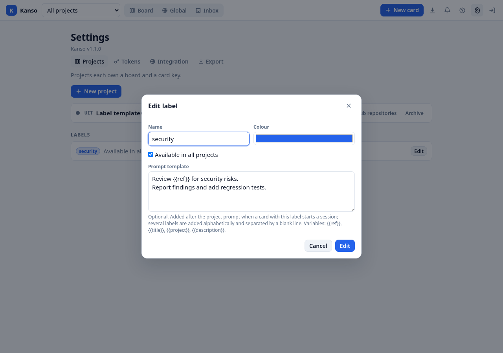
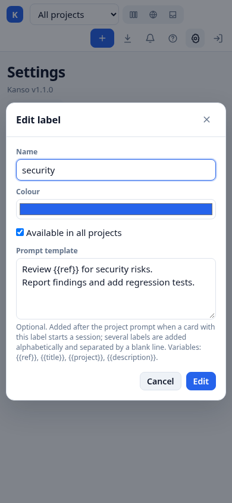

# KANSO-30 — Label prompt templates

## Status

Scope confirmed by the human through grilling Q1–Q5 on KANSO-30. Each label
may carry one optional prompt template. Implementing the label form, API
surface and documentation is explicitly in scope; prompt composition and
dispatch remain in the main implementation session.

## Scope

- Store one nullable `prompt_template` on each label, in the existing label
  record. There is no separate template catalog and no project-specific copy.
- Create and edit the template in the existing label create/edit form. The
  request card does not require a separate preview.
- Compose the template into the prompt for a newly dispatched session, in the
  same way the project prompt is already appended.
- Document the behaviour and cover it with backend composition tests and the
  manual UI checks in `TESTING.md`.

Out of scope: a CLI command for templates, a prompt preview, editing an existing
session's prompt, changing reply/retry prompts, or applying templates to cards
whose session already exists.

## Data and API

- Migration v9 adds `labels.prompt_template TEXT`, nullable, with no length
  limit beyond the existing project prompt convention.
- Label responses expose `prompt_template` as a string or `null`. The field is
  also present in the versioned export because labels are exported through the
  same scoped-label shape.
- `POST /api/labels` accepts an optional `prompt_template`. `PATCH
  /api/labels/:id` accepts it too: a string replaces the template, `null`
  clears it, and omitting the field keeps the current value. This mirrors the
  project prompt template API. Unknown fields remain rejected.
- Templates are human-only label writes, like the rest of label management.
  Agent tokens may read the label template where they can read labels, but
  cannot edit it.
- A template made only of whitespace contributes nothing during composition;
  it is equivalent to no prompt. Clearing is always available by saving an
  empty label template in the UI (`null` in the API).

## Prompt composition

For an initial dispatch only:

1. The built-in dispatch prompt comes first.
2. The project prompt template is appended next when it is non-blank.
3. Every label currently attached to the card is appended after the project
   prompt. Labels are ordered by name using a case-insensitive comparison, then
   by label id as a deterministic tie-breaker.
4. A `NULL` or whitespace-only label template is skipped. Non-blank templates
   are joined with exactly one blank line (`\n\n`) between sections.
5. The existing variables are rendered in one pass over the joined prompt:
   `{{ref}}`, `{{title}}`, `{{project}}` and `{{description}}`. Text inserted by
   a variable is not scanned again, so a value containing `{{ref}}` stays
   literal.

All attached labels participate, regardless of whether their current project
scope still includes the card's project. The label remains attached until it is
removed from the card; scope controls availability for new attachments, not the
prompt of an existing attachment.

Existing sessions are never updated, and reply or retry prompts keep their
existing composition. Only a newly dispatched initial session uses the templates
current at that time.

## UI

- The label create/edit dialog has an optional **Prompt template** textarea
  below the name, colour and scope fields.
- It follows the project form conventions: the textarea is sent as-is, empty
  input sends `null` (which clears an existing template), and the dialog uses
  the same save/cancel behaviour.
- A short hint names the append point, the alphabetical order, the blank-line
  separator and the supported variables, and notes that it applies when a
  session starts.
- Label settings show **Prompt template set** beside labels that have a
  non-blank template, so the behaviour is discoverable without opening each
  label.
- All strings live in `web/i18n/en.js`; the form remains keyboard and screen
  reader accessible through the existing modal helpers.

## Screenshots

## Acceptance criteria

- Creating a label with a template and reopening its edit form shows the saved
  text; saving an edit persists it; clearing the textarea removes it.
- A PATCH that omits `prompt_template` leaves an existing template unchanged; a
  PATCH with `null` clears it.
- A dispatch with multiple templated labels appends them after the default and
  project prompts in case-insensitive name order, separated by one blank line,
  and skips blank templates.
- Variables render once. Labels attached before a scope change still contribute
  their templates.
- Existing sessions and reply/retry prompts are unchanged.
- No CLI template command and no prompt preview are added.
