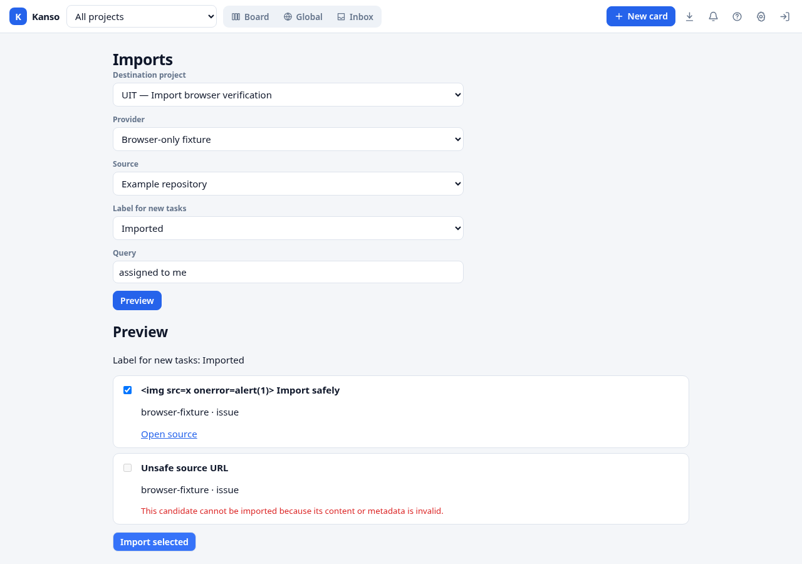

# KANSO-36: import batch label

The human approved this complete specification on 2026-11-16.

- Select at most one existing global or destination-project-compatible Kanso
  label before preview; none is the default. No persisted default, per-item
  override, remote label copying or automatic label creation.
- Show the selection once in the preview. Label changes invalidate the preview;
  project changes invalidate it and reset the label.
- Bind the ID to the server snapshot. Clients omitting it remain compatible.
  Validate existence and scope at preview, before confirmation, and inside each
  new-card transaction. A missing or out-of-scope label must not result in an
  unlabeled creation; retain per-item outcomes for later failures.
- Label only new tasks, atomically with creation. Existing, skipped, archived
  imports and retries remain unchanged. Record normal `label_added` activity and
  include labels in `task.created`; existing prompt-template behavior applies.
- Cover scope, missing labels, compatibility, snapshot immutability, retries,
  events, transactionality and UI invalidation with regression tests. Document
  the behavior, capture a non-secret screenshot, and provide a disposable local
  manual-test setup. Final verification and PR creation belong to the coordinator.

## Screenshot

The screenshot uses a disposable local server and synthetic browser fixture data.
The browser test writes `imports-desktop.png` to `KANSO_IMPORTS_SCREENSHOTS`;
the captured file is copied here under the name above.

## Disposable local manual test

After building with `cargo build --bin kanso`, start a loopback-only instance
with a new private data directory under `~/.cache/tmp/opencode`, an independently
chosen `KANSO_PASSWORD`, `KANSO_BIND=127.0.0.1:8087`, and
`KANSO_PUBLIC_URL=http://127.0.0.1:8087`. Clear `KANSO_OPENCHAMBER_URL`,
`KANSO_OPENCHAMBER_TOKEN`, `GH_TOKEN` and `GITHUB_TOKEN`, and set
`GH_CONFIG_DIR` to a new private disposable directory so the server does not
inherit a real GitHub login. Enter the password through a private local terminal,
not into the issue or PR. Create test projects and labels in this instance.
The selector is testable without GitHub; an actual preview needs a separately
authorized test GitHub account and configured test repository. The browser
regression script instead intercepts provider responses locally and uses only
synthetic data; it does not configure a production provider or use credentials.
